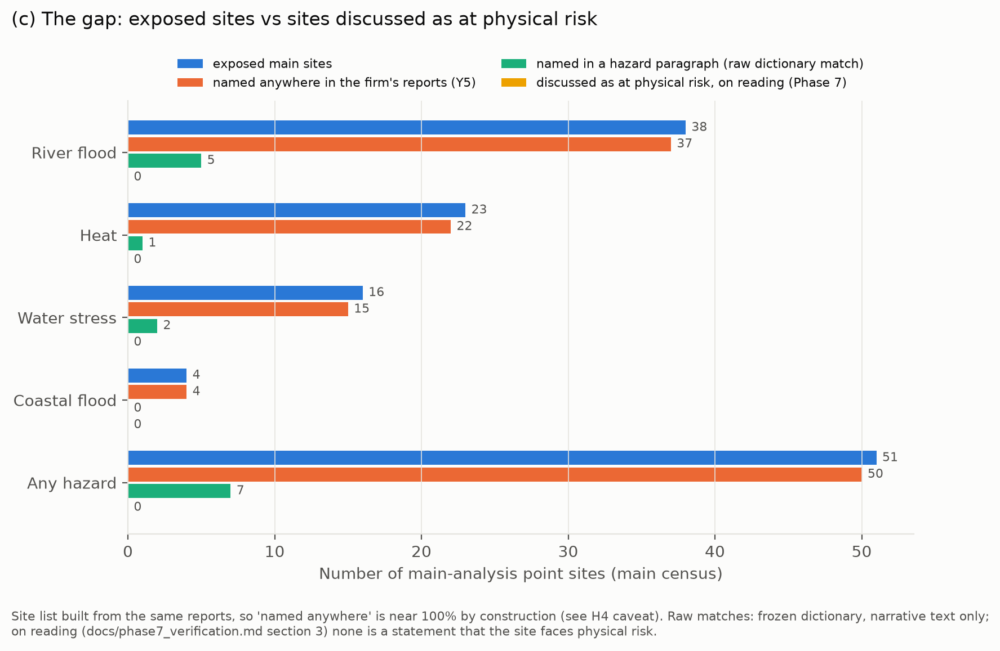

# Disclosed vs Exposed

**Physical climate risk at Nigeria's listed companies ahead of IFRS S2.** A descriptive study comparing what Nigerian Exchange (NGX) companies disclosed about physical climate risk in 2020–2025 with the measured hazard exposure of the sites they name in their own reports.

Author: Malik Kolawole Badmus, independent researcher (BSc Sociology, University of Ilorin).

- **Repository:** https://github.com/malikbadmus79-max/disclosed-vs-exposed
- **Interactive hazard map:** https://malikbadmus79-max.github.io/disclosed-vs-exposed/data/processed/hazard_map.html (via GitHub Pages)

## Contents

- [Why this study](#why-this-study)
- [What it finds: the eight verified claims](#what-it-finds-the-eight-verified-claims)
- [Key figure](#key-figure)
- [How the study was run](#how-the-study-was-run)
- [What is in this repository](#what-is-in-this-repository)
- [How to reproduce](#how-to-reproduce)
- [Limitations](#limitations)
- [AI-use statement](#ai-use-statement)
- [Citation and licences](#citation-and-licences)

---

## Why this study

IFRS S2 asks companies to say where their physical climate risks are concentrated (paragraph 13(b)) and what share of their assets is vulnerable to them (paragraph 29(c)). Nigeria makes IFRS S1/S2 reporting mandatory for public-interest entities from periods beginning on or after 1 January 2028 (SEC circular, 23 September 2026). The years 2020–2025 are therefore a pre-mandate baseline.

The study asks how firms' disclosures relate to the measured exposure of their own sites. It answers descriptively and makes no causal claim. It also makes no claim about motives or compliance.

- **Paper:** [`paper/paper.md`](paper/paper.md) (also as [`paper/paper.docx`](paper/paper.docx)).
- **Short abstract:** [`paper/abstract_short.md`](paper/abstract_short.md).
- **Policy brief:** [`brief/disclosed_vs_exposed_policy_brief.pdf`](brief/disclosed_vs_exposed_policy_brief.pdf). This is the corrected version of 18 November 2026; it replaces an earlier draft.
- **Every number used, with its source file:** [`paper/key_numbers.md`](paper/key_numbers.md).

## What it finds: the eight verified claims

Each claim describes the documents held: 56 main-census firms, 99 firm-years, 2020–2025. Each was verified in Phase 7 ([`docs/phase7_verification.md`](docs/phase7_verification.md), §8), and each still holds after the robustness checks (§9–10).

1. **Physical-risk language is rare.** In 68 of 97 firm-years with narrative text, no paragraph uses any term of the frozen hazard dictionary. On average, about 0.3% of narrative paragraphs do. *(Dictionary precision 0.65; recall not measured.)*
2. **Exposed sites are almost never discussed as being at physical risk.** Of 51 main point sites exposed to river flood, heat, coastal flood or water stress, 50 are named somewhere in their firm's reports. On reading, none is named in a statement that the site faces physical climate risk. The only asset-level physical-risk assessment found is Seplat's FY2025 licence-area assessment.
3. **Heat is the clearest silence.** 15 firms have heat-exposed sites (ERA5), and 2 ever use heat terms. Under NASA POWER heat, the figures are 13 and 2.
4. **Most firms do not say where their plants are.** 22 of 29 firms without an exposure score describe their facilities only generically. 16 of the 29 hold only financial-statement filings.
5. **Firm characteristics account for more variation than exposure.** Size, ownership and sector explain more variation in hazard language than measured site exposure does: ΔR² 0.17 against 0.04, difference −0.13 (95% bootstrap interval −0.37 to −0.06). *Descriptive, not a test; the institutional block has more parameters.*
6. **No clear trend over 2020–2025** in hazard language within firms. All intervals include zero. *Most firms have two years.*
7. **2028 readiness is narrow** (analyst-coded, not validated). In their latest year held, 2 of 56 firms (MTN Nigeria and Seplat) show all five physical-risk elements: resilience, scenario analysis, metric, risk process and locations. 50 show none.
8. **Regulatory facts.** IFRS S1/S2 reporting becomes mandatory in Nigeria for public-interest entities from periods beginning on or after 1 January 2028 (SMEs 2030), with voluntary adoption in 2024–2027. IFRS S2 13(b) and 29(c) ask where physical risks are concentrated and what share of assets is vulnerable.

**Not claimed:**
- whether exposure is related to site-specific disclosure;
- any confirmatory result;
- motives, intent or non-compliance by any firm;
- anything resting on ClimateBERT outputs.

## Key figure



For each hazard, the figure shows four counts:
- exposed main point sites;
- sites named anywhere in the firm's reports;
- sites named in a hazard paragraph (a raw dictionary match);
- sites discussed as at physical risk on reading, which is 0 for every hazard.

## How the study was run

**Frozen design.** [`docs/design.md`](docs/design.md) was written and frozen on 7 November 2026, before any exposure score or text measure was computed. Parameters are in [`config/parameters.json`](config/parameters.json).

**Amendments.** Every later change is a dated amendment, A1–A26, in [`docs/amendments.md`](docs/amendments.md), logged before it was applied. Each records whether any outcome data had been seen.

**Descriptive only.** The design planned three confirmatory hypotheses, conditional on the hazard dictionary reaching a precision of 0.80. One external checker found 0.65 (30 of 46 snippets), so under the pre-set rule (A20/A21) every result is descriptive.

| Phase | What | Write-up |
|---|---|---|
| 0 | Feasibility audit, census frame, access rules | `docs/phase0_audit.md` |
| 1 | Design frozen | `docs/design.md` |
| 2 | Document test, issuer identity, facility records and coordinates (71 main point sites) | `docs/phase2_sites.md` |
| 3 | Hazard exposure: JRC river flood, ERA5 heat (NASA POWER robustness), Aqueduct coastal flood and water stress | `docs/phase3_hazards.md` |
| 4 | Corpus (107 documents), OCR, segmentation, section tagging, dictionaries, precision check, outcome measures | `docs/phase4_corpus.md` |
| 5 | Controls, gap tables, H1–H4 (descriptive), charts | `docs/phase5_analysis.md` |
| 6 | IFRS S2 mapping, policy codes P1–P7, Seplat case, recommendations | `docs/phase6_policy.md` |
| 7 | Verification of every number, re-reading, robustness checks (7b) | `docs/phase7_verification.md` |
| 8 | Paper | `paper/` |

## What is in this repository

**Licences:** code is under MIT; text, figures and derived data are under CC BY 4.0 (see [Citation and licences](#citation-and-licences)).

| Folder | Contents |
|---|---|
| `src/` | All analysis code |
| `config/` | Frozen parameters and dictionaries |
| `docs/` | Design, amendments, phase write-ups, data sources (with URLs and SHA-256) |
| `data/processed/` | Site records and coordinates, site hazard scores, firm exposure scores, outcome measures per firm-year, analysis datasets, policy codes, hazard map. Also the reproduction inputs: control values (`controls_firm_year.csv`), the precision checker's answers (`precision_answers_C1.csv`) and the census frame (`ngx_census_frame.csv`) |
| `data/report_manifest.csv` | One row per report used (107 corpus documents, plus 2 Seplat documents used only in Phase 6). Gives document id, firm, fiscal year, type, source URL or "owner browser download", SHA-256, pages and whether an OCR copy was used. It contains no text |
| `outputs/tables/`, `outputs/figures/` | All result tables and figures |
| `paper/`, `brief/` | Paper, short abstract, number list, policy brief |

### Not included, and why

| Item | Why |
|---|---|
| Company reports (PDFs) and anything under `data/raw/` | Copyright of the issuing companies; size |
| **Any text taken from company reports:** `data/interim/paragraphs.csv`, `data/interim/text/`, the precision-check snippets (the checker's yes/no answers *are* included), policy-coding candidate sentences, the validation sample, the control-variable candidate passages | Copyright |
| IFRS S2 | Personal, non-commercial licence. It is cited by paragraph number and paraphrased |
| Raw hazard files (JRC, Aqueduct, ERA5, NASA POWER, WorldPop, OpenStreetMap extract) | Size, and their own licences. Download them from source (below) |
| Other intermediate files under `data/interim/` | Rebuilt by the scripts. Some contain report text. Scripts read their inputs from `data/interim/`: copy the reproduction inputs there from `data/processed/` (step 3) |
| `data/processed/sites_map.html`, `data/processed/spotcheck_app.html` | Review tools whose pop-ups quote report text |

### Redacted in this copy

Report wording was replaced by a placeholder such as `[text from a company report removed in the public copy]`. The redactions were checked against the private corpus: no remaining run of 12 words matches report text, except standard document titles and statement headings.

| File | What was removed |
|---|---|
| `data/processed/policy_codes_evidence.csv` | Keeps firm, year, code, value, document, page, paragraph id and candidate id only. Passages and notes are removed |
| `data/processed/controls_firm_year.csv` | Keeps values, sources and page references only. The analyst notes (`ta_note`, `assurance_evidence`, `foreign_evidence`, `flag`) are removed |
| `data/processed/ngx_census_frame.csv` | Keeps tickers, issuer names, sectors, strata, board flags, document test and statuses only. Cover text, principal-activity quotes and source notes are removed |
| `data/processed/facilities.csv`, `facilities.geojson` | Columns `location_as_written` (the location as quoted from the report) and `note` are removed. Coordinates, grades, place names and stated states are kept |
| `data/processed/spotcheck_gradeA.csv` | Column `report_quote` is removed |
| `config/dictionary_sites.json` | The `location_as_written` values are replaced by a placeholder. The matching terms and rules are unchanged, but **the file's SHA-256 therefore differs from the frozen hash recorded in `docs/amendments.md`** |
| `src/phase2_build_facilities.py`, `src/phase2_coordinates.py`, `src/phase2_identity_round3.py`, `src/phase2_verify_identity.py` | String literals that quoted report locations or "principal activities" sentences are replaced by placeholders. **These Phase 2 scripts no longer rebuild their outputs exactly**; start from `data/processed/facilities.csv` |
| `docs/coding_guide.md` | The worked examples quoted from reports are replaced by placeholders. The codebook was never used (A20) |
| `docs/data_sources.md` | Local folder paths are generalised |

Short phrases of a few words from reports remain in the phase write-ups and the paper where they document a finding (for example "storm water design study").

## How to reproduce

### 1. Environment

Python 3.12 is used throughout:
```
python -m venv .venv
.venv\Scripts\activate        # Windows; use source .venv/bin/activate elsewhere
pip install -r requirements.txt
```
OCR also needs Tesseract 5.4.0 and Ghostscript 10.08.0 (`docs/data_sources.md`, "OCR tools").

### 2. Quick check from this repository alone

These steps re-run the descriptive models and charts from `data/processed/`:
```
python src/phase5_models.py h1      # -> outputs/tables/h1_results.csv (appends; delete the file first)
python src/phase5_models.py h2      # -> outputs/tables/h2_results.csv
python src/phase5_models.py h3      # -> outputs/tables/h3_results.csv
python src/phase5_charts.py         # -> outputs/figures/
python src/phase7b_robustness.py models baseline rp10 rp500 depth05 b5km no_fs dwl fp20 fp20_alt loso
```
All bootstraps use 9,999 replications with seed 20261118.

### 3. Full reproduction

**Download the source files.** Each source's URL, access route, licence and SHA-256 is in [`docs/data_sources.md`](docs/data_sources.md). Check every hash after download.

| Data | Source | Where the hashes are |
|---|---|---|
| Company reports (107 documents, FY2020–FY2025) | Company websites, the NGX filings library and registrars (47 documents with a direct URL), and owner browser downloads from africanfinancials.com, sustainabilityreports.com and company sites (source pages in `docs/data_sources.md`). Respect each site's robots.txt and terms | [`data/report_manifest.csv`](data/report_manifest.csv): one SHA-256 per document |
| JRC river flood maps v2.1.2 (RP10, RP100, RP500; permanent water) | https://jeodpp.jrc.ec.europa.eu/ftp/jrc-opendata/CEMS-GLOFAS/flood_hazard/ | `docs/data_sources.md`, "Phase 3 hazard data" (16 files) |
| WRI Aqueduct Floods v2.0, coastal RP100 | https://datasets.wri.org/datasets/aqueduct-floods-hazard-maps (browser download) | `inuncoast_historical_nosub_hist_rp0100_0.tif`, SHA-256 `03886acc…cb1` (full hash in `docs/data_sources.md`) |
| WRI Aqueduct 4.0 water risk | https://www.wri.org/data/aqueduct-global-maps-40-data (browser download) | `aqueduct-4-0-water-risk-data.zip`, SHA-256 `bd3ed2bc…fc3` |
| ERA5 hourly 2 m temperature, 43 points, 1991–2025 | Copernicus CDS `reanalysis-era5-single-levels-timeseries` (free account; `src/phase3_era5_ts.py`) | `docs/data_sources.md`, ERA5 section |
| NASA POWER daily T2M_MAX, 29 cells (robustness) | https://power.larc.nasa.gov/data-access-viewer/ | `docs/data_sources.md` (29 hashes) |
| WorldPop Global2 R2025A, Nigeria 100 m | https://hub.worldpop.org/ | `docs/data_sources.md` |
| OpenStreetMap Nigeria extract (Geofabrik, 2026-11-11) | https://download.geofabrik.de/africa/nigeria-latest.osm.pbf | SHA-256 `44dc394e…afa` |

**Run the scripts in order.** Each script's docstring gives its usage.

1. **Text preparation:** `readability.py run`, then `phase2_ocr.py`, then `text_select.py` (OCR and page selection; A1–A5, A12).
2. **Hazards:** `phase3_download.py jrc` and `phase3_download.py worldpop`. Then `phase3_era5_ts.py download all` and `phase3_era5.py score` (ERA5 heat, main), then `phase3_heat.py score manual` (NASA POWER, robustness). Then `phase3_hazards.py flood|coastal|water|permwater|pop|states`, then `phase3_firms.py`. This step starts from `data/processed/facilities.csv`.
3. **Corpus:** `phase4_corpus.py inventory`, then `phase4_corpus.py segment`, then `phase4_sections.py tag`, then `phase4_sections.py apply`. The dictionaries are frozen in `config/`; do not rebuild them.
4. **Outcomes:** `phase4_outcomes.py measures`. The precision check needs only the checker's answers and the frozen dictionary: copy `data/processed/precision_answers_C1.csv` into `data/interim/`, then run `phase4_precision_results.py`. This reproduces `precision_results.csv` exactly: 30/46 = 0.65. Re-drawing the snippet sample with `phase4_precision_sample.py` needs the corpus.
5. **Analysis:** to reproduce the controls and analysis dataset without the reports, copy `data/processed/controls_firm_year.csv` and `data/processed/ngx_census_frame.csv` into `data/interim/`. Then run `phase5_models.py data`. This rebuilds `analysis_firm_year.csv` and `sample_flow.csv`; all columns are identical to the published files except four analyst-note columns that are not distributed. Then run `phase5_sites.py`, `phase5_models.py h1|h2|h3` and `phase5_charts.py`. Re-collecting the control values from the reports uses `phase5_controls.py candidates`, then `phase5_controls_build.py`.
6. **Policy coding:** `phase6_policy_codes.py candidates`, then `phase6_policy_codes.py build`.
7. **Verification and robustness:** `phase7_verify_numbers.py`. Then `phase7b_robustness.py cache`, `phase7b_robustness.py desc` and `phase7b_robustness.py models …`. Then `phase8_nasa_heat_check.py`.
8. **Paper:** `phase8_docx.py` exports the paper.

**Known non-determinism:** OCR output can vary with tool versions. The frozen hashes in `docs/amendments.md` refer to the private originals.

## Limitations

The full list (23 items) is in the paper, §7. In brief:

- **Precision below the bar.** The dictionary's precision is 0.65, below the pre-set 0.80, so all analyses are descriptive.
  - **Weak terms:** "storm" and "erosion" are weak.
  - **Not estimable:** precision for the heat terms and "wildfire".
  - **Recall** was not measured.
  - **One checker,** recruited by the author and not blind to the study's purpose.
- **Site-named measures (Y4) are mostly false positives** (10 of 11 on reading) and are not interpreted. The site dictionary was not validated. The promised site-matching variation check (A17) and the location-set check (R1–R3) were not run.
- **Exposure means hazard near a site, not risk.**
  - **Location:** locations are mostly town-level, and buffers are generous.
  - **Heat source:** heat depends strongly on the reanalysis (ERA5 versus NASA POWER).
  - **Coarse layers:** water stress and coastal flood are coarse.
- **Coverage.** 29 of 56 firms have no exposure score. Most firms have one or two years, and many filings are financial statements only. The sample is small, and surviving listed firms only.
- **AI-applied codings have no human validation:** the policy codes P1–P7 and the re-reading of paragraphs. The study is not a compliance assessment.

## AI-use statement

- **Code:** the analysis code was written with Claude Code (Anthropic), under the author's direction.
- **Decisions:** all design decisions, amendment approvals and owner decisions were made by the author.
- **AI analyst work:** within those rules, the AI also acted as analyst for documented, rule-based tasks. These were:
  - assigning site coordinates from stated addresses and OpenStreetMap features;
  - reviewing section tags;
  - reading control values;
  - coding P1–P7;
  - re-reading site-named hazard paragraphs.

  These codings have no independent human validation.
- **Precision check:** the dictionary precision check was done by one external human helper, not the author and not an AI.
- **Drafting:** the paper was drafted with AI assistance from the verified project documents. The author is responsible for its content.

## Citation and licences

Please cite the work using [`CITATION.cff`](CITATION.cff):

> Badmus, M. (2026). *Disclosed vs Exposed: physical climate risk at Nigeria's listed companies ahead of IFRS S2*. https://github.com/malikbadmus79-max/disclosed-vs-exposed

**Licences:**
- **Code** (`src/`, and the configuration files' code-like content): MIT. See [`LICENSE`](LICENSE).
- **Text, figures, tables and derived data** (`docs/`, `paper/`, `brief/`, `outputs/`, `data/processed/`, `config/` dictionaries): Creative Commons Attribution 4.0 International. See [`LICENSE-CC-BY-4.0.md`](LICENSE-CC-BY-4.0.md).

**Third-party data keep their own terms:**
- OpenStreetMap-derived coordinates: © OpenStreetMap contributors, ODbL.
- JRC flood maps: ODbL v1.0 / CC BY 4.0, as stated in their README and copyright file.
- WRI Aqueduct: CC BY 4.0.
- ERA5: CC BY 4.0.
- WorldPop: CC BY 4.0.
- wordfreq data: CC BY-SA 4.0.
