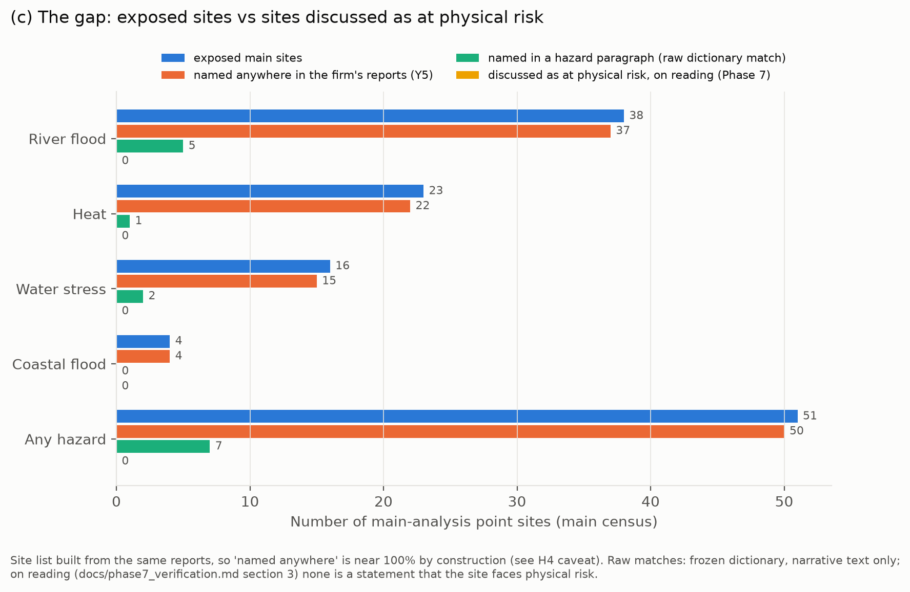
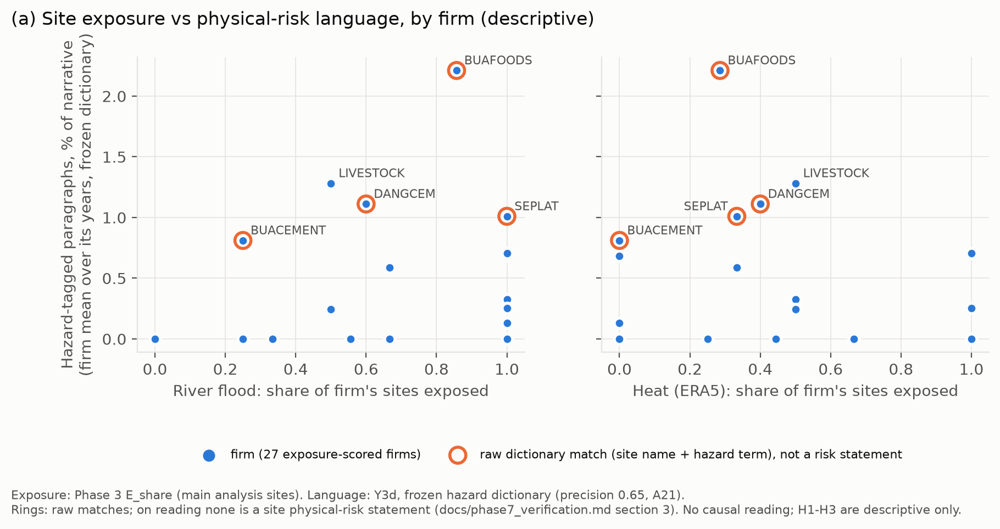
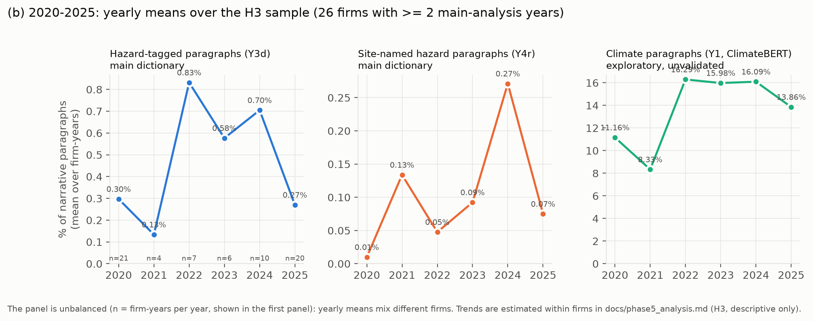

# Disclosed vs Exposed: physical climate risk at Nigeria's listed companies ahead of IFRS S2

**Malik Kolawole Badmus**, independent researcher (BSc Sociology, University of Ilorin)

Full results, data and code: github.com/malikbadmus79-max/disclosed-vs-exposed

*Draft, 18 November 2026. Descriptive study; no confirmatory claims.*

---

## Abstract

IFRS S2 asks companies to say where their climate-related physical risks are concentrated and what share of their assets is vulnerable to them. Nigeria will require IFRS S1/S2 reporting from public-interest entities for periods beginning on or after 1 January 2028. This paper sets a pre-mandate baseline. It compares what Nigerian listed companies disclosed about physical climate risk in 2020–2025 with the measured hazard exposure of the sites they themselves name. The study covers a census of 56 Nigerian Exchange (NGX) firms with physical operations (99 firm-years). Their sites were located and scored against open data for river flood, coastal flood, extreme heat and water stress. Disclosure was measured with a frozen hazard dictionary whose checked precision was 0.65. That is below the pre-set bar of 0.80, so all results are descriptive. In 68 of 97 firm-years with narrative text, no paragraph uses any hazard term. Of 51 exposed point sites, 50 are named somewhere in their firm's reports, but on reading none is named in a statement that the site faces physical risk. Fifteen firms have heat-exposed sites, and two ever use heat terms. Firm characteristics account for more variation in hazard language than measured exposure does. There is no clear within-firm trend over 2020–2025. In their latest year held, 2 of 56 firms show all five physical-risk elements that the 2028 regime will ask for. These patterns hold across the design's robustness checks. We discuss them as a baseline and propose a site-level disclosure table for implementation guidance.

---

## 1. Introduction

Physical climate hazards act on particular places, so investors and regulators can judge such risks only if companies say which of their assets are exposed. IFRS S2, the International Sustainability Standards Board's climate standard, builds this into its requirements. An entity must describe where in its business model and value chain its climate-related risks are concentrated, including by geographical area, facility and type of asset (IFRS S2, paragraph 13(b)). It must also report the amount and percentage of its assets or business activities that are vulnerable to physical risks (paragraph 29(c)).

Nigeria has set a date for these requirements. A circular of the Securities and Exchange Commission (SEC), published on 23 September 2026, makes IFRS S1/S2 reporting mandatory for accounting periods beginning on or after 1 January 2028. Adoption is voluntary until then, and the Financial Reporting Council (FRC) Roadmap adds a compulsory readiness test (section 2.2). The years 2020–2025 are therefore a pre-mandate period, which shows how far companies go before the standard applies.

This paper asks a simple question about that period: **how does what Nigerian listed companies disclose about physical climate risk relate to the measured hazard exposure of their own sites?** We answer it descriptively. We built a census of NGX-listed firms with physical operations in Nigeria and located their sites from their own reports. We scored those sites against open global hazard datasets. We then measured hazard language in 107 annual, integrated and sustainability reports, and compared the two.

The design was written and frozen before any exposure score or text measure was computed (7 November 2026). Every later change was logged as a dated amendment before it was applied (A1–A26). The design planned three confirmatory hypotheses. They were to be tested only if the main text measure passed a precision bar of 0.80. It did not: an external check found a precision of 0.65. Under the pre-set rule, every result in this paper is therefore descriptive. We report effect sizes with intervals, call nothing significant, supported or rejected, and make no causal claim.

The paper makes three contributions. First, it gives a site-level baseline for Nigeria before IFRS S2 applies, built entirely from public documents and open data. Second, it shows a specific gap. The sites that companies name in their own reports are often exposed to physical hazards, yet the reports almost never discuss those sites as being at risk. This is exactly the content that IFRS S2 paragraphs 13(b) and 29(c) ask for. Third, it reports what the 2028 regime will require against what firms showed in their latest year held. It also proposes practical steps for regulators, investors and companies.

The study describes a mismatch. It does not show why firms disclose as they do or assess compliance with a standard that did not yet apply.

Section 2 gives the background and Section 3 the data and methods. Section 4 reports results, and Section 5 examines Seplat Energy. Section 6 discusses policy, Section 7 lists limitations, and Section 8 concludes.

---

## 2. Background

### 2.1 What IFRS S2 asks about physical risk

IFRS S2 *Climate-related Disclosures* applies to annual reporting periods beginning on or after 1 January 2024 (paragraph C1). Its scope covers physical risks (paragraph 3(a)(i)). The requirements on physical risk can be grouped in four parts. We paraphrase them and cite them by paragraph number.

- **Identification.** An entity describes the climate-related risks that could reasonably be expected to affect its prospects. It states whether each is a physical or a transition risk and over what time horizon it could have effects (paragraph 10(a)–(d)). Appendix A defines physical risks as acute (event-driven, such as floods and heatwaves) or chronic (longer-term shifts).
- **Location.** An entity describes where its climate-related risks are concentrated in its business model and value chain, for example by geographical area, facility or type of asset (paragraph 13(b)).
- **Assessment and resilience.** An entity bases its disclosures on information it can obtain without disproportionate cost or effort, including past events, current conditions and forecasts (paragraph 11). It assesses the climate resilience of its strategy using climate-related scenario analysis suited to its circumstances (paragraph 22, with application guidance in B1–B18). It describes its risk-management processes, including its data sources, its use of scenarios and how it assesses likelihood and magnitude (paragraph 25(a)(i)–(iii)).
- **Metrics.** An entity discloses the share and amount of its assets or activities exposed to climate-related physical risk (paragraph 29(c)). The application guidance links this metric to where risks are concentrated (B65(b)).

Taken together, paragraphs 13(b), 29(c) and B65(b) call for a disclosure that ties hazards to places and assets. That is the object this study measures. IFRS S2 also lets entities judge what is material. A firm may assess a hazard and judge it immaterial. The general materiality provisions are in IFRS S1, which is referred to here but was not read for this study, so we do not characterise it.

### 2.2 Nigeria's route to mandatory reporting

Three Nigerian instruments frame the study period. All three were read and their key statements were checked against the source in the verification phase.

1. **SEC circular (23 September 2026).** The circular "Implementation of the IFRS Sustainability Disclosure Standards in Nigeria" sets three things. Implementation Plans are due by 15 October 2026. Reporting under IFRS S1/S2 is mandatory for accounting periods beginning on or after 1 January 2028, and for SMEs from 1 January 2030. Voluntary adoption runs from 1 January 2024 to periods ending 31 December 2027.
2. **FRC Roadmap (amended 2026).** The Roadmap for the Adoption of IFRS Sustainability Disclosure Standards in Nigeria sets three phases (PDF pp19–20). Phase 1 covers early adopters, to 31 December 2023. Phase 2 covers voluntary adopters, 2024–2027. Phase 3 is mandatory for all public-interest entities from 1 January 2028, and for SMEs from 1 January 2030. Before the first sustainability report, a readiness test is compulsory. It collects, among other documents, a climate-risk materiality assessment and a description of scenario-analysis models (pp20–21). Assurance is required from the third year of reporting (p30). The Roadmap lists "climate resilience of strategy and business model to both transition and physical risks" as a disclosure area (p23). It also lists "climate-related physical risks" as a cross-industry metric category (p25).
3. **NGX Sustainability Disclosure Guidelines.** The Guidelines were approved by the SEC on 9 November 2018. They state that risk management "begins with detecting key risks of operational disruptions from climate change, resource scarcity, or community issues" (p8).

All study years fall before the mandate. FY2020–FY2023 fall in or before the FRC's early-adopter phase, and FY2024–FY2025 fall in the voluntary phase. Secondary press coverage suggests the SEC and FRC timelines may not match exactly. We did not verify this and rely only on the primary texts above.

### 2.3 Decoupling and prior work

Institutional theory describes gaps between formal structures and practice. Meyer and Rowan (1977) describe organisations adopting formal structures as myth and ceremony, for legitimacy rather than for the work itself. Bromley and Powell (2012) distinguish two forms of decoupling:
- **Policy–practice decoupling:** policies are adopted but not implemented.
- **Means–ends decoupling:** policies are implemented but only loosely linked to the outcomes they are meant to serve.

Marquis, Toffel and Zhou (2016) study selective disclosure under scrutiny and norms. Marquis and Qian (2014) contrast symbolic and substantive corporate social responsibility reporting.

Climate disclosure research has measured such statements at scale with ClimateBERT, a language model for climate-related text (Webersinke et al., 2021). Bingler, Kraus, Leippold and Webersinke (2022) apply it to corporate climate-risk disclosures under the heading of "cheap talk and cherry-picking". In a later study, the same authors relate cheap talk to firms' climate initiatives, emissions and reputation risk (Bingler et al., 2024). For Nigeria, a panel study of NGX-listed firms (2010–2024) relates climate-risk disclosure and board climate oversight to return on assets and Tobin's Q (Yahaya, 2026). As far as we are aware, no study compares Nigerian firms' disclosure with the measured hazard exposure of their own sites.

This study uses decoupling only as a descriptive frame. Following the frozen design, a mismatch between disclosure and exposure is treated as a descriptive measure of *possible* decoupling. It is not treated as evidence of intent or misconduct by any firm.

---

## 3. Data and methods

### 3.1 Design, freeze and amendments

The study design was written and frozen on 7 November 2026, before any hazard score, corpus measure or model was computed. The parameter file and design were hashed at the freeze. Every later change was logged as a numbered amendment (A1–A26), with its date, its reason and whether any outcome data had been seen. Each amendment was logged before it was applied. The amendments that matter most for reading the results are these:

- **A6:** grade-A site locations were cross-checked by a documented rule instead of the owner's visual spot-check.
- **A10–A11:** ERA5 became the main heat source; NASA POWER was kept as a robustness check.
- **A14:** narrative and financial-statement sections were tagged by a documented rule with analyst review, instead of by hand.
- **A16:** the trend analysis (H3) counts only firm-years ending on or after the firm's listing date.
- **A17:** fixed the dictionary matching rules.
- **A20:** the planned human validation of the ClimateBERT classifiers was dropped by owner decision. The frozen dictionary measures became the main outcomes, the ClimateBERT measures became exploratory, and a dictionary precision check was set with a pre-set rule (section 3.5).
- **A21:** applied the precision result (all hypothesis analyses descriptive) and added an exploratory refined dictionary.
- **A22:** fixed the estimators and the collection of control variables before any model was run.
- **A23:** excluded one file (labelled NNFM FY2020) that proved to be another company's report.
- **A25:** set the rules for coding firm-year policy elements.
- **A26:** corrected one control value (Vitafoam FY2025 total assets) found wrong in verification.

### 3.2 Census and documents

**Census.** The census frame was the NGX equities price list of 6 November 2026 (146 tickers). Each ticker was classified by activity. Funds and other non-operating instruments, and firms without physical operations in Nigeria, fall outside the census. The rest were divided into two strata. The main census has 59 firms with physical operations in Nigeria. A robustness stratum has 18 service firms with physical sites, analysed separately and never pooled. A firm stayed in the census only if a full annual report was available for at least one fiscal year from 2023 to 2025. Three main-census firms failed this test, leaving **56 main-census firms**.

**Documents.** For each firm-year from FY2020 to FY2025, we collected annual reports and any separate sustainability or integrated reports. Each document's type was recorded: full annual report, integrated report, sustainability report or extract, or financial-statement-only filing. Financial-statement-only filings stay in the corpus, because "no narrative disclosure" is itself a finding.

**Retrieval.** Reports were downloaded with a robots-aware client. Where company sites refused automated access, the project owner downloaded the files by hand in a browser. No access restriction was circumvented.

**Corpus.** The final corpus has 107 documents (12,143 pages) covering 103 firm-years. Of these, 100 are main-census firm-years. One is excluded (A23), which leaves **99 main-census firm-years**. Most firms are represented by one or two years.

**Text processing.**
- Text was extracted with PyMuPDF.
- A readability check flagged garbled text layers. A document passed if at least 25% of its tokens were among the 1,000 most common English words (A1; word list from wordfreq 3.1.1, Speer, 2022).
- Scanned or garbled documents were processed with OCRmyPDF and Tesseract. Pages were selected by documented rules (A2–A5, A12).
- Paragraphs were segmented from text blocks. Paragraphs of at least 40 words that were not duplicates were "scored". Narrative sections were separated from the audited financial statements (A14).

The corpus contains 15,601 scored narrative paragraphs.

### 3.3 Sites and locations

**Facility records.** Facility records were built by reading each firm's own reports. The design gives point sites a location grade:
- grade A: an exact address or coordinate;
- grade B: town or industrial estate;
- grade C: state only;
- grade D: not stated.

Coordinates were assigned by the analyst from stated addresses and OpenStreetMap features (© OpenStreetMap contributors, ODbL; see AI-use statement), with no web geocoding service.

**Main analysis set.** The main analysis set contains **71 grade-A and grade-B point sites** that are not offices: 26 grade A and 45 grade B. They are plants, breweries, mills, terminals, flow stations, estates and similar. Grade-A locations were cross-checked by a documented rule (A6). Of the 26 grade-A sites, 22 are only town or suburb centroids.

**Dispersed assets.** Telecom networks, oil and gas licence areas and depot networks were recorded separately as dispersed assets. No exposure score was defined for them.

**Firms without a score.** A firm receives an exposure score only if it has at least one main-analysis point site. Of the 56 main-census firms, **27 have an exposure score** and 29 do not. Section 4.4 reports why.

### 3.4 Hazards and exposure

Four hazards were scored at each site. Only baseline (present-day) hazard enters the analysis.

| Hazard | Data | Exposure rule (main) |
|---|---|---|
| River flood (primary) | JRC Global river flood hazard maps v2.1.2, 1-in-100-year (RP100) depth, about 90 m (Baugh et al., 2024) | Any cell inside the site buffer has depth > 0 m |
| Heat (primary) | ERA5 hourly 2 m temperature, 1991–2025, one series per 0.25° cell (Copernicus Climate Data Store) | Score = 2020–2025 mean annual count of days above the cell's 1991–2020 90th percentile of daily maxima, minus the 1991–2020 mean. A site is exposed if it is in the top tercile of main sites (cut-off 58.8 days per year) |
| Coastal flood | WRI Aqueduct Floods v2.0, coastal, baseline, RP100, about 0.9 km (WRI, 2020) | Any touching cell has depth > 0 m |
| Water stress | WRI Aqueduct 4.0, baseline annual water stress (Kuzma et al., 2023) | The site's sub-basin is in the "High" or "Extremely High" category |

**Buffers.**
- Grade-B sites have a 2 km circle.
- Grade-A sites have a 500 m circle, or a wider circle matching the location's stated precision.
- Sites mapped from an OpenStreetMap polygon use the polygon plus 250 m.

**Firm scores.** For each firm and hazard, the main exposure measure is `E_share`, the share of the firm's main sites that are exposed. No capacity weights are used.

**Exposure counts.** Of the 71 main sites:
- 43 are exposed to river flood;
- 25 to heat;
- 18 to water stress;
- 5 to coastal flood.

Restricted to the main-census firms with documents, **51 main point sites are exposed to at least one hazard**: 38 to river flood, 23 to heat, 16 to water stress and 4 to coastal flood.

**Population.** Population near exposed sites was also computed (WorldPop, 2025). It is not used in this paper.

These measures describe hazard near a site. They do not describe damage or risk. The hazard maps model no flood protection, and the buffers are deliberately generous for imprecise locations. The robustness checks (section 3.8) vary the return period, the depth threshold and the buffer size.

### 3.5 Text measures and the precision check

**Hazard dictionary.** The hazard dictionary was frozen before any count was made. After amendment A20 it has 16 terms:

> flood, flooding, inundation, rainfall, storm, drought, water scarcity, water stress, extreme heat, heatwave, extreme temperature, erosion, sea level, coastal, desertification, wildfire

Bare "heat" was dropped and "extreme heat" was added. The rule for this was set before any count, because in this corpus "heat" is mostly process heat ("waste heat recovery"). A paragraph is **hazard-tagged** if it contains at least one term.

**Site dictionary.** The site dictionary (214 sites) holds each site's facility name, its town or estate name and alternative spellings found in the firm's own reports. A paragraph **names a site** if it contains a site's town or estate name together with that firm's facility context. Generic words such as "plant" are never used alone.

**Outcomes.** The main outcomes are computed per firm-year over scored narrative paragraphs:

- **Y3d (hazard share):** hazard-tagged paragraphs as a share of all scored paragraphs.
- **Y4d, Y4s, Y4r (site-named hazard measures):** the count of hazard-tagged paragraphs that also name one of the firm's sites (Y4d). It is also expressed as a share of hazard-tagged paragraphs (Y4s) and as a share of all scored paragraphs (Y4r).
- **Y5 (site ever named):** whether a site is named anywhere in the firm's documents.

ClimateBERT classifiers (Webersinke et al., 2021) were also run, but they could not be validated after A20, so their outputs are exploratory. No result in this paper rests on them.

**Precision check (A20).** Before any count was made, a stratified sample of hazard-tagged snippets was drawn with a fixed seed. Each family of hazard terms was sampled, with at most five snippets per firm. The frame could supply only 46 snippets under these caps, not the planned 100. The owner accepted the shortfall before any count. One external helper, who was neither the author nor an AI, answered one question for each snippet: is the highlighted word used about a real weather or climate hazard? The pre-set rule had two parts. If overall precision was below 0.80, the hypothesis analyses would be reported as descriptive only. Terms below 0.50 precision (with at least five snippets) would be listed as limitations.

**Result (A21).** Overall precision was **30 of 46 = 0.65** (exact 95% interval 0.50–0.79). Precision differed sharply by family:

| Term family | Correct / checked |
|---|---|
| Flood | 13/14 |
| Drought / water stress | 9/10 |
| Heat | 3/3 (too few to estimate) |
| Coastal / erosion / sea level | 4/11 |
| Storm | 1/8 |
| Wildfire | 0/0 (not estimable) |

As the rule required:
- **All hypothesis analyses (H1–H3) are descriptive only.**
- "Storm" (1/8) and "erosion" (2/6) are listed as limitations. "Coastal" (1/4) is noted separately.
- The frozen dictionary remains the main measure.

A **refined dictionary**, without storm, erosion and coastal, is reported as an exploratory check. It was chosen after the precision results were seen.

Recall, that is, hazard talk the dictionary misses, was not measured.

### 3.6 Verification by reading

In the verification phase, every paragraph behind a non-zero site-named hazard measure was re-read in full. There were 11 paragraphs in 8 firm-years. **Ten were false positives:** donation tables, executive biographies, community-support items and a drainage design study, each of which happened to contain a hazard word and a site name. **One was a genuine statement** that a named asset faces physical risk: Seplat Energy's FY2025 assessment of a licence area (section 5). Because of this, the Y4 measures mostly record false positives. We do not interpret them beyond the fact that genuine site-level physical-risk statements are almost absent.

Every number quoted in the analysis documents was then recomputed from the data files. Twelve flagged control values were checked against their source pages, and one was corrected (A26). The processing steps from dictionaries to models and charts were re-run from their inputs. Of 35 hashed outputs, 28 were byte-identical and the rest changed only as the correction implied.

### 3.7 Descriptive models

The design's three hypotheses were estimated as descriptive models with the estimators fixed in A22. Intervals use 9,999 bootstrap replications and are clustered by firm.

- **H1** (exposure and site-specific disclosure): Y4s regressed on firm exposure with controls and year and sector fixed effects. The controls are log total assets, a foreign parent holding at least 50%, external assurance, a Big Four auditor and a financial-statement-only filing.
- **H2** (exposure versus firm characteristics): Y3d, comparing the R² added by an exposure block (river flood and heat `E_share`) with that added by an institutional block (size, foreign parent, assurance, Big Four, sector), each given the other. The comparison uses standardised variables and a firm pairs bootstrap.
- **H3** (trend): within-firm yearly trends in Y3d and Y4r, each scaled by its standard deviation, with a wild cluster bootstrap.
- **H4** (silence on exposed sites): the share of exposed sites never named (Y5 = 0), with exact binomial intervals.

The H1 and H2 sample is the 27 exposure-scored firms (69 firm-years). The H3 sample is the 26 firms with at least two main-analysis years and narrative text (66 firm-years).

### 3.8 Robustness checks

The design (section h) listed eleven robustness checks. Check 5, OLS in place of the fractional logit, was run in the analysis phase. The verification phase found that most of the others had not been run, and nine were then run in full (Phase 7b):

1. river flood at 1-in-10-year (RP10) and 1-in-500-year (RP500) return periods;
2. flood depth of at least 0.5 m;
3. 5 km buffers for grade-B sites;
4. excluding financial-statement-only firm-years;
5. excluding the two firms carrying the NGX "DWL" board flag, whose meaning could not be verified;
6. the 18-firm robustness stratum, analysed separately;
7. leave-one-sector-out;
8. dispersed-asset firms, analysed separately;
9. a 20% foreign-parent threshold.

**Check 1 was not run.** This is the alternative location sets R1–R3: adding grade-C sites, adding sites located only from OpenStreetMap, and report-only locations.

**Checks outside the design list:**
- **Phase 7b variant:** the 20% threshold with Seplat's FY2025 parent coded under the pre-sale reading.
- **Analysis phase:** NASA POWER heat, 500 m grade-A buffers (A7) and the exclusion of permanent water (A8).
- **Phase 8:** the heat-silence count under NASA POWER (section 4.3).

### 3.9 Policy coding

Each firm-year was also coded against seven policy elements drawn from IFRS S2 and the FRC Roadmap (A25):

- **P1:** resilience of strategy to physical risk;
- **P2:** scenario analysis;
- **P3:** a physical-risk metric;
- **P4:** physical risk in the risk-management process;
- **P5:** locations or assets at physical risk identified;
- **P6:** adoption status;
- **P7:** reference to the NGX Guidelines.

**Method.** Keyword searches produced 403 candidate sentences, and every one was read. A code was set to 1 only with page evidence. Doubtful cases were coded 0.

**Validation.** The codes were applied by the analyst (see the AI-use statement) and have no human validation or reliability statistic. In verification, all 38 positive codes were confirmed on their pages. A random sample of 20 zero-coded candidates was found correctly coded.

The codes are descriptive and enter no model.

---

## 4. Results

All results describe the documents held for 2020–2025 and are descriptive.

### 4.1 Sample

**Table 1. Sample flow**

| Step | Firm-years | Firms |
|---|---|---|
| Main-census firm-years with documents | 100 | 56 |
| Minus NNFM FY2020 (A23: wrong company) | 99 | 56 |
| H1/H2: firms with an exposure score, all controls | 69 | 27 |
| H1 primary outcome defined (at least one hazard-tagged paragraph) | 25 | 12 |
| of which a hazard paragraph names a site (raw dictionary match) | 8 | 4 |
| H3: firms with at least two main-analysis years (with narrative text) | 68 (66) | 27 (26) |

*Source: `outputs/tables/sample_flow.csv`. "68 (66) | 27 (26)": the H3 sample has 68 firm-years from 27 firms; 66 firm-years from 26 firms contain narrative text, because Cadbury's two filings are financial statements only.*

### 4.2 Physical-risk language is rare

Of the 99 main-census firm-years, 97 contain narrative text. **In 68 of these 97, no paragraph uses any term of the frozen hazard dictionary.** On average, about 0.3% of narrative paragraphs are hazard-tagged (mean Y3d 0.0031). This is the gross rate. With a measured precision of 0.65, the rate of genuine hazard paragraphs is probably lower. Because recall was not measured, some hazard talk worded differently is also missed.

The pattern holds under every check (section 4.7):
- Excluding financial-statement-only filings, 39 of 68 firm-years have no hazard paragraph, and the mean share is 0.44%.
- In the robustness stratum, none of the 3 firm-years has a hazard paragraph.
- With the exploratory refined dictionary, the number of firm-years without a hazard paragraph rises.

### 4.3 Exposed sites are named, but not as being at risk

**Table 2. Firms with exposed sites and their use of hazard terms (main census, all years held)**

| Hazard | Firms with ≥ 1 exposed site | … that ever use that hazard's terms |
|---|---|---|
| River flood | 21 | 6 |
| Heat | 15 | 2 |
| Water stress | 13 | 4 |
| Coastal flood | 2 | 2 |

*Source: `outputs/tables/gap_firm_hazard.csv`. "Heat terms" are extreme heat, heatwave and extreme temperature.*

**Table 3. Exposed main point sites: named anywhere, and named in physical-risk text**

| Hazard | Exposed sites | Named anywhere in the firm's reports | Named in a hazard-tagged paragraph (raw dictionary match) | Named in a genuine physical-risk statement (on reading) |
|---|---|---|---|---|
| River flood | 38 | 37 | 5 | 0 |
| Heat | 23 | 22 | 1 | 0 |
| Water stress | 16 | 15 | 2 | 0 |
| Coastal flood | 4 | 4 | 0 | 0 |
| **Any hazard** | **51** | **50** | **7** | **0** |

*Source: `outputs/tables/gap_sites_by_hazard.csv`; last column from the verification re-reading (section 3.6).*

**Exposed sites are named, but not as being at risk.** Of the 51 main point sites exposed to river flood, heat, coastal flood or water stress, 50 are named somewhere in their firm's reports. The dictionary finds 7 of them in a hazard-tagged paragraph. On reading, none of these 7 matches is a statement that the site faces physical climate risk. **On reading, none of the 51 exposed sites is named in such a statement.** The only asset-level physical-risk assessment found in the corpus is Seplat Energy's FY2025 assessment of its licence areas (section 5).

**H4.** The design's H4 asked what share of exposed sites is *never* named. The answer is 1 of 51 (2.0%; exact 95% interval 0.05%–10.4%). This result is near-mechanical: the site list was built by reading the same reports, so almost every site is named somewhere by construction. We report H4 as designed but do not read it as evidence of openness about sites. The informative contrast is between columns 3 and 5 of Table 3.

**Heat is the clearest silence.** Fifteen firms have at least one heat-exposed site under the main (ERA5) heat measure, and two of them ever use a heat term. Heat exposure depends strongly on the reanalysis used (section 7). Under NASA POWER heat, 13 firms have a heat-exposed site, and the same two use heat terms. The claim therefore holds under both sources, although the exposed firms differ: 9 are exposed under both (`outputs/tables/robustness_8_nasa_heat_silence.csv`).

**Figure 1.** For each hazard, four counts of main point sites: exposed sites; sites named anywhere in the firm's reports; sites named in a hazard paragraph (raw dictionary match); and sites discussed as at physical risk on reading (0 for every hazard; section 3.6). The site list was built from the same reports, so "named anywhere" is near 100% by construction. *File: `outputs/figures/c_gap_exposed_vs_named.png`.*

### 4.4 Most unscored firms do not say where their plants are

Twenty-nine of the 56 main-census firms have no exposure score. We classified each firm's facility records by a fixed order of reasons.

**Table 4. Why 29 main-census firms have no exposure score**

| Reason | Firms | of which FS-only in every year held |
|---|---|---|
| A. Only an office or registered address stated | 0 | – |
| B. Dispersed assets only (networks, licences, depots) | 2 | 1 |
| C1. Facility stated only generically ("Factory", "Brewery"), with no place named | 22 | 13 |
| C2. Place named in the report, but no coordinate could be assigned | 5 | 2 |
| **Total** | **29** | **16** |

*Source: `outputs/tables/unscored_firms_reasons.csv`.*

**Twenty-two of the 29 unscored firms describe their facilities only generically.** Sixteen of the 29 hold only financial-statement filings, where facility locations are rarely stated. This is a disclosure finding in its own right. IFRS S2 paragraph 13(b) asks where risks are concentrated, including by facility. Many listed firms with physical operations do not yet say where their facilities are. It also limits the study: the exposure analyses rest on the 27 firms that do name their sites.

### 4.5 Firm characteristics account for more variation than exposure

**Table 5. H2: R² added to Y3d by each block, given the other (69 firm-years, 27 firms)**

| Outcome | Exposure block | Institutional block | Difference (exposure − institutional) |
|---|---|---|---|
| Y3d, frozen dictionary (main) | 0.04 (0.00 to 0.15) | 0.17 (0.11 to 0.43) | −0.13 (−0.37 to −0.06) |
| Y3d, refined dictionary (exploratory) | 0.02 | 0.23 | −0.21 (−0.43 to −0.11) |

*95% firm pairs bootstrap intervals, 9,999 replications. Source: `outputs/tables/h2_results.csv`.*

Among the 27 exposure-scored firms, firm characteristics (size, ownership, sector) explain more of the variation in hazard language than measured site exposure does. The R² added is 0.17 against 0.04. The difference is −0.13, with a 95% bootstrap interval of −0.37 to −0.06.

This is a description, not a test, and it has a structural caveat. The institutional block has more parameters: four variables plus sector dummies, against two exposure variables. Raw R² gains favour larger blocks, and no adjustment was planned or made. The result applies only to the 27 scored firms.

**Figure 2.** Firm-level site exposure (share of sites exposed to river flood, left, and heat, right) against the firm's mean share of hazard-tagged paragraphs, for the 27 exposure-scored firms. Rings mark a raw dictionary match (a site name and a hazard term in the same paragraph, in some year). They are not risk statements: on reading, none is a statement that the site faces physical risk (section 3.6). The figure is descriptive and supports no claim about a relationship between exposure and site-specific disclosure. *File: `outputs/figures/a_exposure_vs_disclosure.png`.*

### 4.6 No clear trend in 2020–2025

**Table 6. H3: within-firm trends, in standard deviations per year (26 firms, 66 firm-years)**

| Version | Hazard language (Y3d) | Site-named hazard rate (Y4r) | Difference |
|---|---|---|---|
| Main (post-listing years, A16) | +0.013 (−0.113 to +0.141) | +0.052 (−0.015 to +0.120) | −0.039 (−0.147 to +0.071) |
| Pre-listing years included | +0.007 (−0.111 to +0.126) | +0.049 (−0.014 to +0.112) | −0.041 (−0.142 to +0.061) |
| Refined dictionary (exploratory) | +0.057 (−0.043 to +0.156) | +0.048 (−0.018 to +0.114) | +0.009 (−0.077 to +0.096) |

*95% wild cluster bootstrap intervals. Source: `outputs/tables/h3_results.csv`.*

Within firms, there is no clear trend in hazard language over 2020–2025, and every interval includes zero. The data are thin. Most firms have two years, usually 2020 and one recent year. The Y4r side rests on the same few, mostly false-positive matches as the other Y4 measures. We therefore read Table 6 only as the absence of a clear rise in hazard language. It does not establish a gap between the two trends.

**Figure 3.** Yearly means over the H3 sample. The panel is unbalanced: the number of firm-years per year is shown in the first panel, and the yearly means mix different firms. Table 6 gives the within-firm trends. The middle panel (Y4r) rests on raw dictionary matches. The right panel (Y1, ClimateBERT) is exploratory and unvalidated; it is shown for completeness only and no claim rests on it. *File: `outputs/figures/b_trend_2020_2025.png`.*

**H1.** We do not interpret the primary H1 model, which relates exposure to site-specific disclosure (Y4s). Its outcome exists for 25 firm-years of 12 firms, and only 8 of them, from 4 firms, are non-zero. The fractional logit failed in 80–86% of bootstrap draws. Most importantly, the non-zero values are almost all false positives (section 3.6). We therefore make no statement in either direction about whether exposure is related to site-specific disclosure.

### 4.7 2028 readiness

We coded each firm's latest firm-year held against the elements the 2028 regime will ask for. For 46 firms the latest year is FY2025, for 7 it is FY2024 and for 3 it is FY2023. The codes were applied by the analyst and have no human validation (section 3.9).

**Table 7. Policy elements in each firm's latest year held (56 main-census firms)**

| Code | Element (IFRS S2 anchor) | Firms |
|---|---|---|
| P1 | Resilience of strategy to physical risks (22) | 4 |
| P2 | Climate scenario analysis used (22, B1–B18) | 4 |
| P3 | Physical-risk metric reported (29(c)) | 2 |
| P4 | Physical or climate risk in the risk-management process (25) | 5 |
| P5 | Locations or assets at physical risk identified (13(b), 29(c), B65(b)) | 4 |
| P6 | Reports in accordance with IFRS S1/S2 (voluntary) | 2 |
| P6 | Readiness, plans or partial alignment only | 4 |
| P7 | Refers to the NGX Sustainability Disclosure Guidelines | 2 |

*Source: `data/processed/policy_codes_firm_year.csv`.*

**Two of the 56 firms (MTN Nigeria and Seplat Energy) show all five physical-risk elements, P1 to P5, in their latest year held. Fifty show none.** Six show at least one. The same two firms state that their FY2025 disclosures were prepared in accordance with IFRS Sustainability Disclosure Standards.

**FS-only filings.** Twenty-six of the 56 latest years are financial-statement-only filings, so a zero there also reflects the type of document held.

**Dispersed assets.** Both firms with all five elements hold dispersed assets: MTN Nigeria a telecom network, and Seplat licence areas alongside point sites. Among the 45 firms with point sites only or no stated facilities, none shows all five.

### 4.8 Robustness

**Table 8. Main descriptive results under each check (Phase 7b)**

| Check | Firm-years with narrative / no hazard paragraph | Exposed sites / named / named in hazard paragraph (raw match) | Heat: firms exposed / use terms | Latest year: all five / none (of firms) |
|---|---|---|---|---|
| Baseline | 97 / 68 | 51 / 50 / 7 | 15 / 2 | 2 / 50 (56) |
| River flood RP10 | same | same | same | same |
| River flood RP500 | same | same | same | same |
| Depth ≥ 0.5 m | same | same | same | same |
| 5 km grade-B buffer | same | 57 / 56 / 7 | same | same |
| Excluding FS-only firm-years | 68 / 39 | 49 / 45 / 7 | 14 / 2 | 2 / 31 (37) |
| Excluding DWL-flagged firms | 95 / 66 | 51 / 50 / 7 | 15 / 2 | 2 / 48 (54) |

*Source: `outputs/tables/robustness_7b_descriptive.csv`.*

**Descriptive results.**
- Under every check, none of the exposed sites is named in a genuine physical-risk statement. The re-reading covered every site-named hazard paragraph, whatever the exposure definition.
- In the robustness stratum (3 firm-years), 5 sites are exposed and none is named in a hazard paragraph.
- The count of unscored firms describing facilities only generically does not depend on any check.

**H2.** The difference in R² added (exposure minus institutional) lies below zero in every check:
- **Baseline and flood or buffer variants:** about −0.13 under the baseline and each of the four flood and buffer variants.
- **Excluding FS-only firm-years:** −0.15 (−0.43 to −0.06).
- **20% foreign-parent threshold:** −0.13 (−0.39 to −0.06).
- **That threshold with Seplat's FY2025 parent coded under the pre-sale reading:** −0.10 (−0.37 to −0.04).
- **Leave-one-sector-out:** from −0.06 to −0.19. The weakest case leaves out Industrial Goods: −0.06 (−0.37 to −0.01). There, external assurance is constant once Dangote Cement leaves the sample, and it is dropped.

The direction is stable, and the size moves with the sample.

**H3.** All 27 trend intervals include zero: τ for Y3d, τ for Y4r and their difference, under the baseline, the exclusion of FS-only years and each of the seven leave-one-sector-out samples.

*Source: `outputs/tables/robustness_7b_models.csv`.*

None of the checks reverses or materially weakens any of the main descriptive findings.

---

## 5. A closer look: Seplat Energy

Seplat Energy is the census firm with the most developed sustainability reporting held. We describe it to show what site-level physical-risk content looks like, not because it is typical. The corpus holds its 2020 annual report and 2025 integrated report. A 2023 sustainability report and a 2025 social performance report, supplied for the policy analysis, are outside the corpus and change no measure.

**2020.** The 2020 annual report has 1 hazard-tagged paragraph out of 548 scored paragraphs. That is typical of the census. Physical risks are recognised, but strategic resilience is discussed for the energy transition only.

**2023.** The 2023 sustainability report uses hazard terms mainly in statements about water stress. It says Seplat operates in a region of low water stress and that its assets are not identified as at high water risk. This agrees with our exposure data: none of Seplat's three main point sites lies in a high water-stress sub-basin under Aqueduct 4.0. Flooding appears once, as community road drainage.

**2025.** The 2025 integrated report is different in kind.
- It has 12 hazard-tagged paragraphs out of 653 (1.8%, against a census mean of about 0.3%).
- It describes flood and sea-level risks in the Niger Delta.
- It reports an **asset-level physical-risk assessment**. The assessment uses IPCC climate modelling data under three scenarios (SSP1-2.6, SSP2-4.5 and SSP5-8.5) for 2030, 2040 and 2050 (PDF p153), and analyses thirteen hazards for the offshore assets (p154). Its results are given by licence area. For example, Oil Mining Lease (OML) 40 is assessed as significantly exposed to precipitation and pluvial flooding (p153).
- It states that impacts on operations have so far been limited.
- It states that it was prepared in accordance with IFRS Sustainability Disclosure Standards (p112).

This is the single genuine site- or asset-level physical-risk statement that our re-reading found in the corpus. It is the content closest to IFRS S2 paragraphs 13(b) and 22.

**Two gaps remain, even here.**
- **Point facilities.** The assessment works at the level of licence areas. The three point facilities that our hazard data score as exposed (the Sapele gas plant, the Amukpe flow station and the Qua Iboe terminal) are not discussed as being at physical risk. The only dictionary match between one of these sites and a hazard term is a "storm water design study" at Amukpe. On reading, it is a drainage item, not a risk statement.
- **Community framing.** In the 2025 social performance report, flooding appears as a community issue. It describes coastal and rainfall flooding in Ibeno, Akwa Ibom, and canal and gutter clearing funded through host-community trusts. It is not framed as a risk to Seplat's own assets. The Qua Iboe terminal is in Akwa Ibom and is river-flood and heat exposed in our data. Whether it lies in Ibeno itself was not verified.

The case shows a movement between 2020 and 2025, from near-silence to a licence-level assessment of the kind IFRS S2 asks for. It also shows that a firm can assess physical risk at one level (licence areas) while its exposed point facilities, and flooding near its operations, appear only elsewhere or not at all. We do not attribute the change to any cause.

---

## 6. Discussion and policy recommendations

### 6.1 What the pattern means

Taken together, the results describe a consistent pattern for 2020–2025:
- Physical-risk language is rare.
- The sites that firms name in their own reports are often exposed to physical hazards, but they are not discussed as being at risk.
- Many firms do not say where their facilities are.
- Hazard language tracks firm characteristics more than measured exposure, and it did not clearly rise over the period.

The pattern holds when the flood return period, the depth threshold, the buffers, the sample and the foreign-parent threshold change.

**Fit with institutional theory.** The pattern is consistent with decoupling as described in section 2.3. It does not show intent:
- **Policy–practice decoupling** (Bromley & Powell, 2012): formal climate language and framework references exist, while site-level physical-risk content is almost absent.
- **Means–ends decoupling:** disclosure activity is not tied to the places where hazards occur.
- **Selective disclosure** (Marquis, Toffel & Zhou, 2016): firm characteristics account for more variation than exposure, as such accounts would lead one to expect.

**The data cannot separate decoupling from other explanations.**

1. **No mandate.** Every firm-year predates mandatory reporting, so silence may reflect the absence of a requirement rather than any choice.
2. **Materiality.** Firms may have assessed flood or heat and judged them immaterial. If so, the materiality judgement itself is what IFRS S2 would expect them to disclose.
3. **Cost.** No shared national hazard dataset is cited in the reports read. Site-level assessment may be costly, especially for smaller firms. IFRS S2 paragraph 11 limits the information expected to what an entity can obtain without disproportionate cost or effort.
4. **Measurement.** The dictionary has modest precision and unknown recall, and our hazard measures are model-based. They may differ from firms' own assessments. Seplat's licence-level results are one example.

We therefore make no claim about motives. We do not claim that any firm concealed information, and we do not claim that any firm failed to comply with IFRS S2, which did not apply to it.

**What the study offers instead is a baseline.** The 2028 regime will ask for the location-specific content that this study finds missing. The same open-data method, with the same frozen rules, can be repeated on the first mandatory reports. Doing so would show whether the gap narrows.

### 6.2 Recommendations

These are untested proposals for discussion, and none would pre-empt the SEC and FRC timeline.

**R1. A site or asset table in implementation guidance (FRC and SEC).**
- **Proposal:** guidance for the 2028 mandate could ask each reporting entity for a simple table. It would list each material facility or asset type, its location (state or coordinates) and the physical hazards assessed for it. This turns IFRS S2 paragraphs 13(b) and 29(c) into a concrete format.
- **Basis:** of 51 exposed sites, 50 are named in reports, but none is discussed as being at risk. Most firms already list facilities; for the 22 unscored firms that do not, the table would close that gap too.

**R2. A shared national hazard reference (FRC, with national hazard-data holders).**
- **Proposal:** publish or endorse a national reference for flood, heat and water stress that firms can use to screen their sites. It would be the kind of readily obtainable information that IFRS S2 paragraph 11 expects firms to use.
- **Basis:** this study used only open global datasets; a national reference would lower costs, especially for smaller firms. Our heat results also show why a common reference matters: two reanalysis sources ranked sites almost unrelatedly (section 7). Which agency should host such a reference was not examined.

**R3. A per-site check in the readiness test (FRC).**
- **Proposal:** the Roadmap's readiness test already collects a climate-risk materiality assessment and a description of scenario models. It could add a checklist confirming, for each main site and hazard, that physical risk was assessed, even where the result is judged immaterial.
- **Basis:** this would make a materiality judgement visible rather than leaving silence ambiguous, as it is in 68 of 97 firm-years.

**R4. Engagement by investors and the NGX.**
- **Proposal:** in engagement, and in any update to the 2018 NGX Sustainability Disclosure Guidelines, ask issuers which sites were screened for which hazards. Ask them also to report the IFRS S2 29(c) metric.
- **Basis:** investors can run this study's open-data screen on disclosed sites to target questions, with no new regulation.

**R5. Report physical risk where hazards occur (firms).**
- **Proposal:** name the facility, the hazard, the time horizon and the response. Where community flood programmes and company assets share a location, link the two.
- **Basis:** Seplat's 2025 licence-level assessment is a partial model. Extending it to point facilities would meet IFRS S2 13(b) more fully.

**Not recommended:** ranking firms or inferring individual firms' motives, which this sample and these measures cannot support.

---

## 7. Limitations

**Measurement of disclosure**

1. **Precision below the bar.** The dictionary's precision is 0.65 (95% interval 0.50–0.79), below the pre-set 0.80, so all hypothesis analyses are descriptive.
   - **Small check:** the check used 46 snippets (not the planned 100) and one checker, recruited by the author and not blind to the study's purpose.
   - **Weak terms:** "storm" (1/8) and "erosion" (2/6) rarely denote hazards, and "coastal" (1/4) looks weak.
   - **Not estimable:** precision for the heat terms (3 snippets) and "wildfire" (none).
2. **Recall not measured.** Differently worded hazard talk ("flooded", "high temperatures") is missed, so absence of terms is not absence of discussion.
3. **Site measures are mostly noise.** 10 of the 11 site-named hazard paragraphs are false positives. Y4d, Y4s and Y4r, and so H1's primary outcome and the Y4 side of H3, are not interpreted.
4. **Unvalidated site dictionary.** It was not validated; its ambiguity rule was the analyst's proposal. The site-matching variation promised in the design (A17) was not run; the Y4 measures it would affect are not interpreted.
5. **Near-mechanical H4.** The site list came from the same reports.
6. **Unvalidated classifiers.** Human validation was dropped (A20). The ClimateBERT outputs are unvalidated, and no result rests on them.
7. **Post-hoc elements.** The refined dictionary, the "named in hazard text" comparison and the Phase 7b checks came after results were seen. The refined dictionary's precision is optimistic.

**Measurement of exposure**

8. **Hazard, not risk.** The flood maps ignore flood protection. "Exposure" means hazard near a site, not damage.
9. **Location precision.** 22 of 26 grade-A sites are centroids, and buffers of 2–10 km make river-flood exposure generous. The design's alternative location sets (R1–R3) were not run.
   - **Permanent water:** 39 of 71 main buffers contain permanent water, and excluding it cuts river-flood exposure considerably.
   - **Depth artefacts:** two sites have modelled depths over 10 m, which may be artefacts.
10. **Heat depends on the source.** ERA5 and NASA POWER rank sites almost unrelatedly (Spearman −0.01), and 47 of 71 main sites change heat status. The heat-silence count holds under both sources (15 / 2 and 13 / 2).
    - **Shared cells:** many Lagos sites share one cell.
    - **Daily maximum:** taken from hourly values.
    - **Percentile definition:** the percentile pools all base-period days.
11. **Coarse layers.** Water stress is a sub-basin property, not a site's own use. The coastal layer (about 0.9 km) is generous for small buffers.
12. **No score for dispersed assets.** They are described only.

**Coverage and sample**

13. **Half the census is unscored.** 29 of 56 firms have no exposure score, so H1 and H2 rest on 27 firms and do not extend beyond them.
14. **Few years per firm.** Second-tier years were not collected, so 28 firms have one year and do not enter the trend analysis.
15. **FS-only filings.** These are 26 of the 56 latest years, so zeros there partly reflect the document type.
16. **Small N.** About 25–27 clusters and sparse outcomes give wide intervals.
    - **H2 block sizes:** the comparison favours the larger institutional block.
    - **Fractional logit:** it failed in most bootstrap draws.
    - **Degenerate cells:** one leave-one-sector-out cell is degenerate.
17. **Survivorship.** Firms delisted before 6 November 2026 are excluded.
18. **Provisional classifications.** Sectors are provisional, and NGX board-flag meanings (such as "DWL") are unverified. The trend model was not re-estimated without the two DWL firms.
19. **Uneven access.** Some reports came only from the owner's browser downloads or through OCR, and forced OCR lost text on 42 pages. Documents may therefore be missing or degraded unevenly.

**Controls, policy coding and sources**

20. **Judgement in controls.** One control was corrected (A26). Some codings are judgement calls: Beta Glass's indirect foreign parent, and Seplat's FY2025 incoming shareholder treated as Nigerian.
21. **Unvalidated policy codes.** P1–P7 were applied by an AI analyst under documented rules, with no human validation.
22. **Not a compliance assessment.** Most firm-years predate IFRS S2 and the mandate, and a dictionary measures words.
23. **Unverified points.** IFRS S1 was not read. Neither a reported SEC–FRC timing mismatch nor the Qua Iboe terminal's location in Ibeno was verified.

---

## 8. Conclusion

Before IFRS S2 applies in Nigeria, the reports of Nigerian listed companies with physical operations rarely connect physical climate hazards to the places where those hazards were measured.

- **Hazard language is rare:** in 68 of 97 firm-years with narrative text, no paragraph uses a hazard term.
- **Exposed sites are not discussed as at risk:** of 51 exposed point sites, 50 are named in their firm's reports, but none is discussed as being at physical risk.
- **Heat is the clearest silence:** of 15 firms with heat-exposed sites, two ever use heat terms.
- **Many firms do not say where their facilities are:** 22 of the 29 firms without an exposure score describe their facilities only generically.
- **Firm characteristics account for more variation than exposure,** and there is no clear trend over 2020–2025.
- **Readiness for 2028 is narrow:** in their latest year held, 2 of 56 firms show all five physical-risk elements.

These are descriptive findings from public documents and open data, with the measurement limits set out above. They are consistent with decoupling. They are also consistent with a pre-mandate period, with materiality choices and with the cost of assessment. The study cannot tell these apart.

What the study does provide is a baseline, and a method that can be repeated on the first mandatory reports. If the 2028 regime works as IFRS S2 paragraphs 13(b) and 29(c) intend, that repeat should find exposed sites named in physical-risk text, and the gap described here should narrow.

---

## Data and code availability

**Included in the public repository** (code under MIT; text, figures and derived data under CC BY 4.0):
- **Code:** all code (`src/`), at https://github.com/malikbadmus79-max/disclosed-vs-exposed.
- **Frozen inputs:** the design, the amendments log (A1–A26), the dictionaries and parameters (`docs/`, `config/`).
- **Derived data:** site, hazard and exposure scores, outcome measures and policy codes (`data/processed/`).
- **Tables and figures:** `outputs/tables/` and `outputs/figures/`.

**Not included.**
- **Company reports**, and any text taken from them: paragraph text, evidence passages and quoted locations. The evidence file keeps document, page and paragraph identifiers only.
- **IFRS S2**, which is licensed for personal, non-commercial use. It is cited by paragraph number and paraphrased.
- **Raw hazard files.**

**Hashes.** Source and SHA-256 for each company report are listed in `data/report_manifest.csv`, and for the hazard files in `docs/data_sources.md`.

## AI-use statement

**Code.** The analysis code was written with Claude Code (Anthropic), working under the author's direction.

**Decisions.** All design decisions were made by the author. This covers the frozen design, every amendment, every owner decision recorded in the project logs, and the decisions to accept or reject results.

**Rule-based work by the AI.** Within those rules, the AI also acted as the analyst for several documented, rule-based tasks:
- assigning site coordinates from stated addresses and OpenStreetMap features;
- reviewing the rule-based section tags;
- reading control values from report pages;
- coding the P1–P7 policy elements (A25);
- re-reading the site-named hazard paragraphs during verification.

These AI-applied codings have no independent human validation, which is stated as a limitation.

**Precision check.** The dictionary precision check was done by one external human helper, who was neither the author nor an AI. AI-generated codes were never used as validation.

**Drafting.** This draft was prepared with AI assistance from the verified project documents. The author is responsible for its content.

---

## References

**Standards and regulation**

- Financial Reporting Council of Nigeria (2026). *Roadmap Report for the Adoption of IFRS Sustainability Disclosure Standards in Nigeria* (Amended 2026). https://frcnigeria.gov.ng/wp-content/uploads/2026/02/Roadmap-Report-for-the-Adoption-of-IFRS-Sustainability-Disclosure-Standards-in-Nigeria-Amended-2026-.pdf
- Financial Reporting Council of Nigeria (2026, 26 February). Press release: FRC unveils amended roadmap and sustainability reporting guideline. https://frcnigeria.gov.ng/2026/02/26/frc-unveils-amended-roadmap-and-sustainability-reporting-guideline-to-strengthen-adoption-of-ifrs-sustainability-disclosure-standards-in-nigeria/
- IFRS Foundation (2026). *IFRS S2 Climate-related Disclosures*, in *ISSB-2026-A Issued IFRS Standards* (consolidated edition incorporating the December 2025 amendments). Cited by paragraph.
- Nigerian Exchange Group (2018). *Sustainability Disclosure Guidelines* (approved by the SEC, 9 November 2018). https://doclib.ngxgroup.com/regulation-site/IssuersRules/Sustainability%20Disclosure%20Guidelines.pdf
- Securities and Exchange Commission, Nigeria (2026, 23 September). Circular: Implementation of the IFRS Sustainability Disclosure Standards in Nigeria. https://sec.gov.ng/for-investors/keep-track-of-circulars/implementation-of-the-ifrs-sustainability-disclosure-standards-in-nigeria/

**Literature**

- Bingler, J. A., Kraus, M., Leippold, M., & Webersinke, N. (2022). Cheap talk and cherry-picking: What ClimateBert has to say on corporate climate risk disclosures. *Finance Research Letters*, 47(Part B), 102776. https://doi.org/10.1016/j.frl.2022.102776
- Bingler, J. A., Kraus, M., Leippold, M., & Webersinke, N. (2024). How cheap talk in climate disclosures relates to climate initiatives, corporate emissions, and reputation risk. *Journal of Banking & Finance*, 164, 107191. https://doi.org/10.1016/j.jbankfin.2024.107191
- Bromley, P., & Powell, W. W. (2012). From smoke and mirrors to walking the talk: Decoupling in the contemporary world. *Academy of Management Annals*, 6(1), 483–530. https://doi.org/10.5465/19416520.2012.684462
- Marquis, C., & Qian, C. (2014). Corporate social responsibility reporting in China: Symbol or substance? *Organization Science*, 25(1), 127–148. https://doi.org/10.1287/orsc.2013.0837
- Marquis, C., Toffel, M. W., & Zhou, Y. (2016). Scrutiny, norms, and selective disclosure: A global study of greenwashing. *Organization Science*, 27(2), 483–504. https://doi.org/10.1287/orsc.2015.1039
- Meyer, J. W., & Rowan, B. (1977). Institutionalized organizations: Formal structure as myth and ceremony. *American Journal of Sociology*, 83(2), 340–363. https://doi.org/10.1086/226550
- Webersinke, N., Kraus, M., Bingler, J. A., & Leippold, M. (2021). ClimateBert: A pretrained language model for climate-related text. arXiv:2110.12010. https://doi.org/10.48550/arXiv.2110.12010
- Yahaya, O. A. (2026). Climate risk governance and firm performance of listed Nigerian firms. *Journal of Accounting, Finance and Auditing*, 17(3), 10–44. https://doi.org/10.5281/zenodo.19064530

**Data and software**

- Baugh, C., Colonese, J., D'Angelo, C., Dottori, F., Neal, J., Prudhomme, C., & Salamon, P. (2024). *Modelled flood inundation for different return period scenarios at the global scale* (Global river flood hazard maps v2.1.2). European Commission, Joint Research Centre. https://jeodpp.jrc.ec.europa.eu/ftp/jrc-opendata/CEMS-GLOFAS/flood_hazard/ (authors as in the dataset README's recommended citation, which lists them as "Francesco, Dottori" and "Prudhomme; Christe")
- Copernicus Climate Change Service. ERA5 hourly time-series data on single levels from 1940 to present. Climate Data Store. https://cds.climate.copernicus.eu/datasets/reanalysis-era5-single-levels-timeseries
- Kuzma, S., Bierkens, M. F. P., Lakshman, S., Luo, T., Saccoccia, L., Sutanudjaja, E. H., & Van Beek, R. (2023). *Aqueduct 4.0: Updated decision-relevant global water risk indicators*. Technical Note. World Resources Institute. https://doi.org/10.46830/writn.23.00061
- NASA Langley Research Center. POWER Data Access Viewer (MERRA-2 daily T2M_MAX). https://power.larc.nasa.gov/
- OpenStreetMap contributors. OpenStreetMap data (ODbL), via Geofabrik Nigeria extract (2026-11-11) and the Overpass API.
- Speer, R. (2022). *rspeer/wordfreq: v3.0* (v3.0.2) [Software]. Zenodo. https://doi.org/10.5281/zenodo.7199437. Version used: 3.1.1 (PyPI); this is the citation recommended in the 3.1.1 package documentation.
- World Resources Institute (2020). *Aqueduct Floods Hazard Maps* v2.0. https://datasets.wri.org/datasets/aqueduct-floods-hazard-maps
- WorldPop (2025). Global2 R2025A population counts, Nigeria, 100 m, constrained. https://hub.worldpop.org/

**Company documents cited (Seplat case)**

- Seplat Energy Plc. *2020 Annual Report* (corpus).
- Seplat Energy Plc. *Sustainability Report 2023*.
- Seplat Energy Plc. *2025 Integrated Annual Report* (20 April 2026). https://www.seplatenergy.com/investors/results-and-presentations/
- Seplat Energy Plc. *2025 Social Performance Report*.
